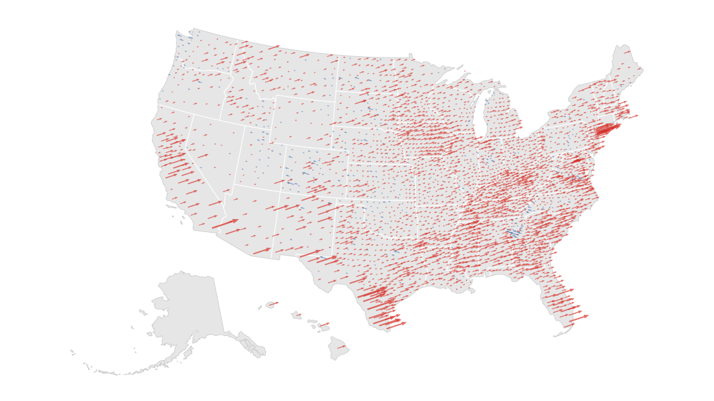
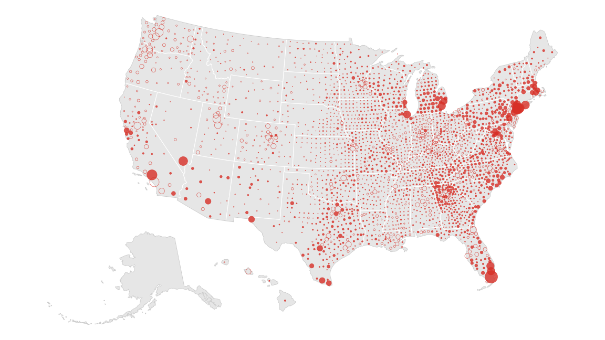
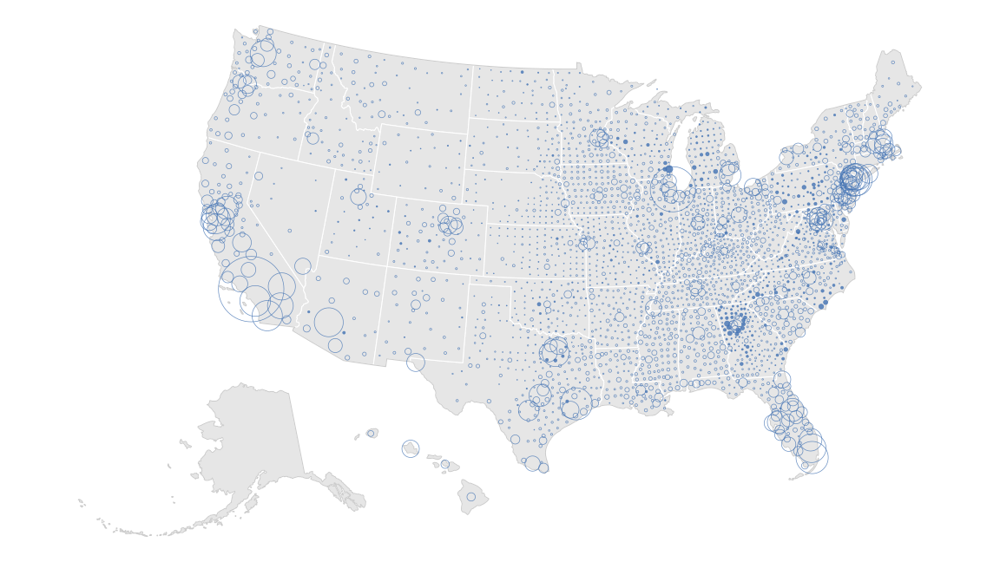

# The Red Wave That Wasn't

**By Matthew Danbury**

If you follow the news, chances are you've seen a map like the one above recently.

What an arrow on this map – sometimes called a margin shift or swing map – represents is the difference in the margins of victory from one election to the next in the county it is anchored to.((For instance, if in the previous election the Democrat ticket received 51% of the vote and the Republican ticket received 47% of the vote, the margin of victory is +4% D. If in this election, the Republican ticket receives 50% of the vote, and the Democratic ticket receives 48% of the vote, the margin of victory now is +2% R, and the margin shift was +6% R.))

I assume these maps have become so ubiquitous because they purport to show a measure of how Americans' support for the two parties has shifted since the last election.

But faithfully interpreting this kind of map is a lot trickier than you might expect. For instance, looking at a part of the map full of red arrows, _can we actually conclude that popular support for the Republican party increased in that region_?

If you couldn't guess from my setup, the answer is no. Knowing that a party achieved better margins compared to last election doesn't tell us anything about how popular support for that party changed.

If this seems counterintuitive, consider the following thought experiment:

Imagine there are three fictional towns — Fighton, Slumperville, and Flopsborough — each with the same population of 1000 voting eligible adults.

By sheer coincidence, all three towns voted the same way in the previous election: 340 people voted Democrat, 310 voted Republican, 16 voted third party, and 336 sat it out for one reason or another.((These vote splits just so happen to be the same as the national averages for the 2020 presidential election.))

|              | Democrat  | Republican | Third Party | Victory Margin |
| ------------ | --------- | ---------- | ----------- | -------------- |
| Fighton      | 340 / 51% | 313 / 47%  | 13 / 2%     | +4% D          |
| Slumperville | 340 / 51% | 313 / 47%  | 13 / 2%     | +4% D          |
| Flopsborough | 340 / 51% | 313 / 47%  | 13 / 2%     | +4% D          |

In this election, however, the towns' voting patterns diverged.

In Fighton, a suburban community in a key swing state, both parties dedicated their best efforts to turning out more voters. While support (as measured by voter turnout) increased for both parties, the Republican candidate came out slightly ahead thanks to a well-timed campaign rally.

|         | Democrat  | Republican | Third Party | Victory Margin |
| ------- | --------- | ---------- | ----------- | -------------- |
| Fighton | 353 / 48% | 368 / 50%  | 15 / 2%     | +2% R          |

Slumperville is a different story. The local economy, based disproportionately around all-you-can-eat buffets and karaoke houses, took a sharp dive during the pandemic and hasn't really recovered since. Voters don't think either candidate has a strong plan to get people back to singing and sharing serving utensils and consequently, both parties shed voters. However the Democrats, being the incumbents, lose them in greater numbers.

|              | Democrat  | Republican | Third Party | Victory Margin |
| ------------ | --------- | ---------- | ----------- | -------------- |
| Slumperville | 289 / 48% | 301 / 50%  | 12 / 2%     | +2% R          |

In Flopsborough — a quiet costal town with cozy bed and breakfasts and a small liberal arts college — the same number of older, reliably Republican voters turn out to vote as last time, but an ill-phrased answer to a culturally sensitive question during a debate costs the Democrat the support of Flopsborough's college activists, who decide to not vote in protest.

|              | Democrat  | Republican | Third Party | Victory Margin |
| ------------ | --------- | ---------- | ----------- | -------------- |
| Flopsborough | 300 / 48% | 313 / 50%  | 13 / 2%     | +2% R          |

When we go to make our margin shift map, something curious happens: Even though the changes in popular support for each party were different for each town, they all wound up having the same margin shift: 6 points to the right.((This margin shift just so happens to be the margin shift at the national level from 2020 to 2024.))

|              | Victory Margin Shift | Change in Democrat Support | Change in Republican Support |
| ------------ | -------------------- | -------------------------- | ---------------------------- |
| Fighton      | +6% R                | +1.3% of eligible voters   | +5.5% of eligible voters     |
| Slumperville | +6% R                | -5.1% of eligible voters   | -1.2% of eligible voters     |
| Flopsborough | +6% R                | -4.0% of eligible voters   | no change                    |

What this little thought experiment demonstrates is that every map of margin shift is ambiguous. It's impossible to know whether a given red arrow resulted from an increase in support for the Republican ticket or a decrease in support for the Democrat ticket.

While this makes no difference as to the outcome of the election, it makes an _enormous_ difference in the conclusions we are to draw about changing political beliefs across the country.

Data is never the whole story. Rather, the point of data is to constrain the narratives through which we understand the world. It can help us to decide which narratives are even worth entertaining.

Showing margin shift by itself is to risk entertaining narratives about _how_ the margin shifted that we could handily dismiss by showing it's constituent components of changes in Democrat and Republican support.

When it comes to the 2024 election, these constituent components reveal the "red wave" to be predominantly a "blue flop". Whereas the Trump ticket saw mixed gains and losses compared to 2020, the Harris ticket had a total wipeout:

While we are still left to speculate _why_ the support for each party shifted in this way, any story we tell must conform to this general shape.

The goal of journalism is to leave people with an accurate impression of the world, not merely to say things that are technically true.

While there is nothing objectively false about a map of margin shift, it is simply too easy for the uninitiated viewer to misinterpret for it to keep its spot in primetime.
